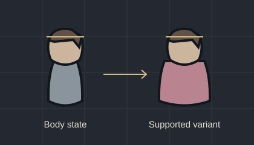
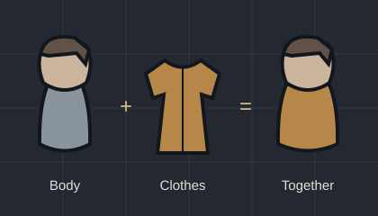
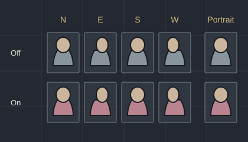

For creators / Themes

# Make a theme

The body, the clothes, and the checks that bring them together.

<strong>Planning brief</strong>The renderer is not ready. File formats, sizes and final asset counts are still undecided.

<a href="#bodies-and-anatomical-variants">Body layers</a><a href="#clothing-and-masks">Clothing</a><a href="#validation-captures">Comparison captures</a>

<h2 id="bodies-and-anatomical-variants">Body layers</h2>

<figure><figcaption>Diagram: change the supported region.</figcaption></figure>

Show the external parts the character actually has, on the correct side and at the supported size. Reuse existing head and accessory layers where possible.

<strong>Decide first:</strong> art style, initial body profiles, size categories and the states that need their own drawing.

Body mapping and fallback rules

<ul>
<li>Body owns anatomy. Themes draws it; changing the theme must not create a part or repeat an operation.</li>
<li>Regions, attachment points, masks and drawn versus generated variants still need agreement.</li>
<li>Missing artwork needs a usable fallback. Competing providers need an explicit selection.</li>
<li>Internal organs belong in the medical diagram, not automatically on the map.</li>
</ul>

## Clothing and masks

<figure><figcaption>Diagram: body and clothes stay aligned.</figcaption></figure>

<h3>Adapt existing outfits</h3>
The first prototype should reshape the bust locally using existing clothing images. A dedicated variant can replace that result when needed.

<strong>Prototype first:</strong> choose a small wardrobe and establish what needs an override before drawing a variant for every size.

Clothing cases to cover

<ul>
<li>Check soft and rigid garments, multiple layers, ordinary third-party clothes, unusual openings and custom renderers.</li>
<li>Keep the head, limbs, hem and unrelated accessories unchanged. Never apply the adaptation twice to a supplied variant.</li>
<li>Define masks, override selection and the fallback to the original image. An imperfect fit must not prevent wearing the item.</li>
<li>Body and native systems own coverage and protection. A graphical mask changes only what is drawn.</li>
</ul>

## Validation captures

<figure><figcaption>Capture plan: four directions + portrait.</figcaption></figure>

<h3>Show the same pawn before and after</h3>
Capture rendering off and on, every supported size, all four directions and the portrait. Include native and third-party outfits, an override and a fallback.

<strong>Record:</strong> game and mod versions, tested outfits and visible defects. These captures require a working prototype.

What the comparison must establish

<ul>
<li>Inspect contours, stretching, clothing alignment and accessories in the same scene.</li>
<li>Include soft and rigid garments and multiple layers. Successful outfits establish only their own tested coverage.</li>
<li>Measure graphics cost separately. Screenshots cannot prove performance or unchanged simulation.</li>
<li>Check save/load, switching themes, disabling rendering and removing a theme separately.</li>
<li>Keep concept illustrations, finished assets and game captures clearly labelled.</li>
</ul>

## Shared resources

Use the existing briefs for [medical diagrams](health-display.md), [attachment markers](body.md#attachments-and-test-aids) and [guide illustrations](index.md#shared-documentation-resources). Reuse a suitable comparison capture in a guide.

The mod or pack providing an activity owns its animations and specialist props. This brief does not commission an animation library.

Before using an asset, record its source, author and reuse permission.

[About Themes](../../mods/themes.md) · [All visual briefs](index.md)
