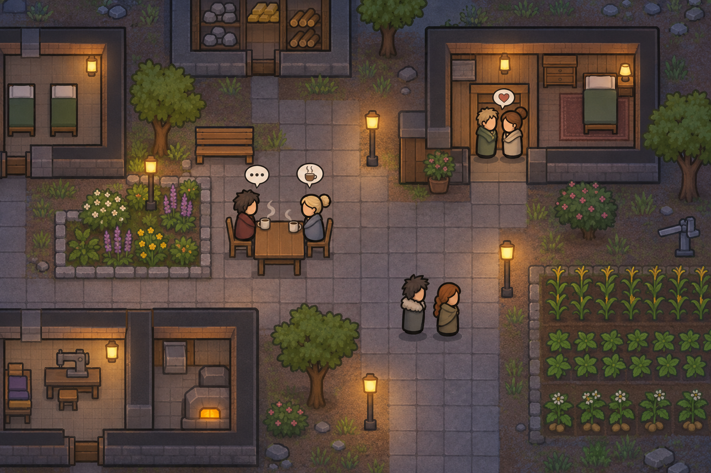
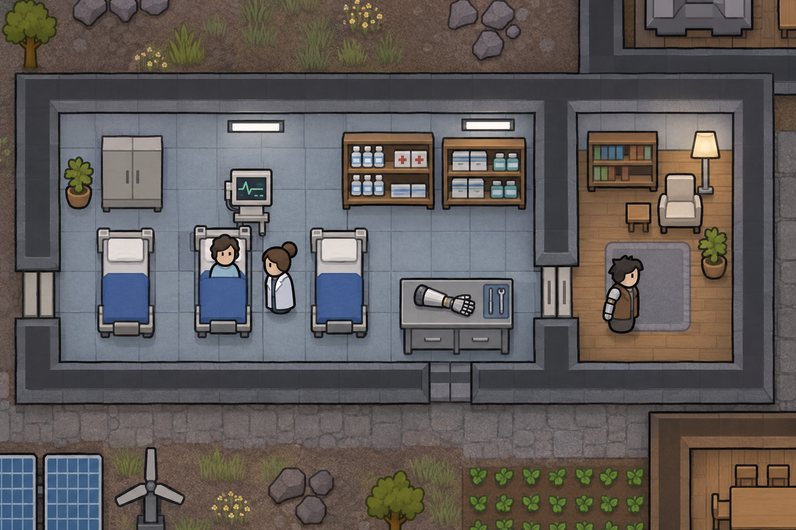
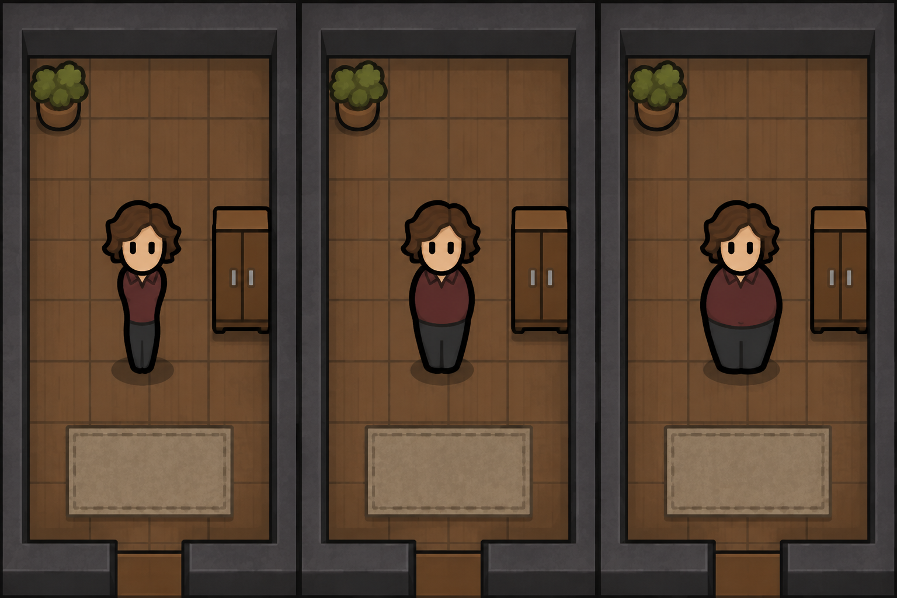

<section class="rt-catalog-hero" aria-labelledby="catalog-title">

Mods for RimWorld 18+<h1 id="catalog-title">RimTease</h1>
Intimacy comes to the rim.

</section>

<strong>Demo catalogue</strong>First-release preview. Images are mock-ups; downloads are unavailable.

<section id="the-mods" class="rt-catalog-list" aria-labelledby="mods-title">

<h2 id="mods-title">Find your mods</h2>3 mods

<form class="rt-catalog-filters" role="search" aria-label="Find mods">
<label class="rt-mod-search">Search<input type="search" id="mod-search" placeholder="Search mods or dependencies…" autocomplete="off"></label>
<label>Category<select id="mod-category"><option value="">All categories</option><option value="gameplay">Gameplay</option><option value="anatomy">Anatomy</option><option value="appearance">Appearance</option></select></label>
<label>Dependencies<select id="mod-dependency"><option value="">Any dependency</option><option value="body">Requires Body</option><option value="standalone">Without Body</option></select></label>
</form>

<article class="rt-mod-card" data-mod-card="core" data-category="gameplay" data-requires-body="true" data-search="RimTease Gameplay Preferences, intimacy and colony rules. RimWeave Body">

Gameplay<h2>RimTease</h2>
Preferences, intimacy and colony rules.

RequiresRimWeaveBody
<button class="rt-open-button" type="button" data-open-mod="core" aria-haspopup="dialog">View RimTease↗</button>

</article>
<article class="rt-mod-card" data-mod-card="body" data-category="anatomy" data-requires-body="false" data-search="Body Anatomy Individual anatomy and medical changes. RimWeave">

Anatomy<h2>Body</h2>
Individual anatomy and medical changes.

RequiresRimWeave
<button class="rt-open-button" type="button" data-open-mod="body" aria-haspopup="dialog">View Body↗</button>

</article>
<article class="rt-mod-card" data-mod-card="themes" data-category="appearance" data-requires-body="true" data-search="Themes Appearance A different look for the same colonist. RimWeave Body">

Appearance<h2>Themes</h2>
A different look for the same colonist.

RequiresRimWeaveBody
<button class="rt-open-button" type="button" data-open-mod="themes" aria-haspopup="dialog">View Themes↗</button>

</article>

<h3>No matching mods</h3><button type="button" data-reset-filters>Clear search and filters</button>

</section>
<noscript>
Enable JavaScript to filter mods and open their illustrated details.
</noscript>
<dialog id="mod-dialog" aria-labelledby="mod-title">

</dialog>
<template id="mod-core">
<header class="rt-detail-header">
Gameplay · v0.1 demo · RimWorld 1.7<h2 id="mod-title">RimTease</h2>
<button class="rt-dialog-close" type="button" data-close-mod aria-label="Close mod details">×</button></header>

Give your colonists an intimate life, with their own preferences and your colony’s rules.

RequiresRimWeave<button class="rt-dependency" type="button" data-open-mod="body">Body</button>Optional<button type="button" class="rt-dependency" data-open-mod="themes">Themes</button>
<button class="rt-download-button" type="button" data-install-mod="core">Install RimTease</button>

<figure class="rt-game-scene"><button class="rt-hotspot" type="button" style="--x:37%;--y:43%" data-feature="0" aria-label="Preferences & traits" aria-pressed="true" aria-controls="feature-caption">1</button><button class="rt-hotspot" type="button" style="--x:72%;--y:28%" data-feature="1" aria-label="Your colony, your rules" aria-pressed="false" aria-controls="feature-caption">2</button><button class="rt-hotspot" type="button" style="--x:60%;--y:68%" data-feature="2" aria-label="Time together" aria-pressed="false" aria-controls="feature-caption">3</button><figcaption>Gameplay mock-up</figcaption></figure>

<button type="button" data-feature="0" aria-pressed="true" aria-controls="feature-caption">1Preferences & traits</button><button type="button" data-feature="1" aria-pressed="false" aria-controls="feature-caption">2Your colony, your rules</button><button type="button" data-feature="2" aria-pressed="false" aria-controls="feature-caption">3Time together</button>

Colonists have their own tastes. A player order and a willing participant are different things.

Set where activities happen and who can take part.

Make room for social moments and private activities in everyday colony life.

<section class="rt-install-panel" hidden><h3>Install RimTease</h3>
Demo only — no files will be downloaded.
<ol><li>RimWorld 1.7</li><li>RimWeave</li><li>Body</li><li>RimTease</li></ol>
<button type="button" disabled>Steam Workshop</button><button type="button" disabled>Download ZIP</button>
</section>
</template>

<template id="mod-body">
<header class="rt-detail-header">
Anatomy · v0.1 demo · RimWorld 1.7<h2 id="mod-title">Body</h2>
<button class="rt-dialog-close" type="button" data-close-mod aria-label="Close mod details">×</button></header>

Give each body its own anatomy. Make changes through the familiar health and surgery systems.

RequiresRimWeave
<button class="rt-download-button" type="button" data-install-mod="body">Install Body</button>

<figure class="rt-game-scene"><button class="rt-hotspot" type="button" style="--x:31%;--y:50%" data-feature="0" aria-label="Individual anatomy" aria-pressed="true" aria-controls="feature-caption">1</button><button class="rt-hotspot" type="button" style="--x:57%;--y:59%" data-feature="1" aria-label="Surgery & replacements" aria-pressed="false" aria-controls="feature-caption">2</button><button class="rt-hotspot" type="button" style="--x:82%;--y:55%" data-feature="2" aria-label="Back to colony life" aria-pressed="false" aria-controls="feature-caption">3</button><figcaption>Gameplay mock-up</figcaption></figure>

<button type="button" data-feature="0" aria-pressed="true" aria-controls="feature-caption">1Individual anatomy</button><button type="button" data-feature="1" aria-pressed="false" aria-controls="feature-caption">2Surgery & replacements</button><button type="button" data-feature="2" aria-pressed="false" aria-controls="feature-caption">3Back to colony life</button>

Keep track of the parts a character has, including replacements and supported size choices.

Use native operations for cosmetic changes, grafts and functional replacements.

Keep ordinary clothing usable. The drawing and the medical result stay separate.

<section class="rt-install-panel" hidden><h3>Install Body</h3>
Demo only — no files will be downloaded.
<ol><li>RimWorld 1.7</li><li>RimWeave</li><li>Body</li></ol>
<button type="button" disabled>Steam Workshop</button><button type="button" disabled>Download ZIP</button>
</section>
</template>

<template id="mod-themes">
<header class="rt-detail-header">
Appearance · v0.1 demo · RimWorld 1.7<h2 id="mod-title">Themes</h2>
<button class="rt-dialog-close" type="button" data-close-mod aria-label="Close mod details">×</button></header>

Choose how bodies and clothing look without changing the character underneath.

RequiresRimWeave<button class="rt-dependency" type="button" data-open-mod="body">Body</button>
<button class="rt-download-button" type="button" data-install-mod="themes">Install Themes</button>

<figure class="rt-game-scene"><button class="rt-hotspot" type="button" style="--x:18%;--y:49%" data-feature="0" aria-label="Choose a silhouette" aria-pressed="true" aria-controls="feature-caption">1</button><button class="rt-hotspot" type="button" style="--x:50%;--y:49%" data-feature="1" aria-label="Keep your wardrobe" aria-pressed="false" aria-controls="feature-caption">2</button><button class="rt-hotspot" type="button" style="--x:82%;--y:49%" data-feature="2" aria-label="Switch it off" aria-pressed="false" aria-controls="feature-caption">3</button><figcaption>Gameplay mock-up</figcaption></figure>

<button type="button" data-feature="0" aria-pressed="true" aria-controls="feature-caption">1Choose a silhouette</button><button type="button" data-feature="1" aria-pressed="false" aria-controls="feature-caption">2Keep your wardrobe</button><button type="button" data-feature="2" aria-pressed="false" aria-controls="feature-caption">3Switch it off</button>

Show the supported body shapes and sizes, while keeping the same character.

Adapt ordinary clothing; use a dedicated variant when a garment needs one.

Return to the original rendering while keeping anatomy, health and equipment.

<section class="rt-install-panel" hidden><h3>Install Themes</h3>
Demo only — no files will be downloaded.
<ol><li>RimWorld 1.7</li><li>RimWeave</li><li>Body</li><li>Themes</li></ol>
<button type="button" disabled>Steam Workshop</button><button type="button" disabled>Download ZIP</button>
</section>
</template>

