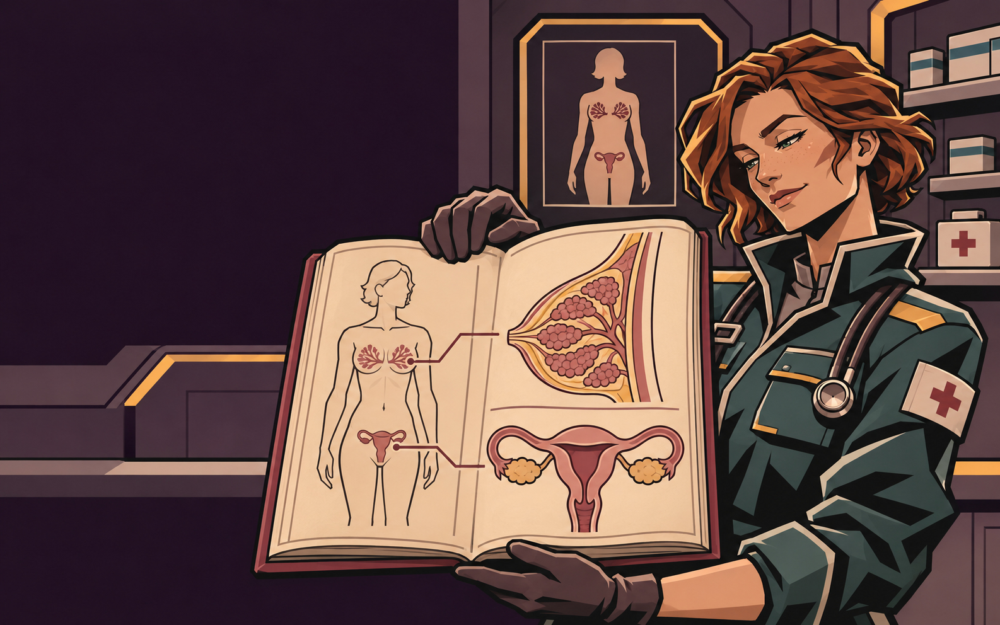
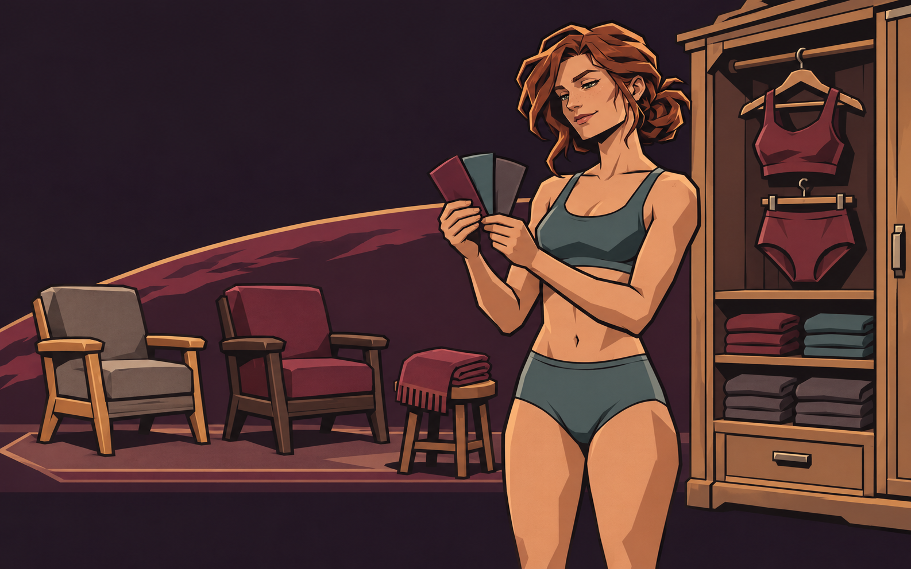

<section class="rt-catalog-hero" aria-labelledby="catalog-title">

Mods for RimWorld 18+<h1 id="catalog-title"></h1>
Intimacy comes to the rim.

</section>

<strong>Demo catalogue</strong>Concept mods, illustrative images and example dependencies. No downloads yet.

<section id="the-mods" class="rt-catalog-list" aria-labelledby="mods-title">

The RimTease collection<h2 id="mods-title">Find your next story.</h2>
5 mods

<form class="rt-catalog-filters" role="search" aria-label="Find mods">
<label class="rt-mod-search">Search<input type="search" id="mod-search" placeholder="What would you like to add?" autocomplete="off"></label>
<label>Category<select id="mod-category"><option value="">All categories</option><option value="gameplay">Gameplay</option><option value="anatomy">Anatomy</option><option value="appearance">Appearance</option></select></label>
<label>Dependencies<select id="mod-dependency"><option value="">Any dependency</option><option value="core">Requires RimTease</option><option value="body">Requires Body</option><option value="positions">Requires Extended Positions</option><option value="rimweave">Requires RimWeave</option></select></label>
</form>
<section class="rt-mod-group" data-mod-group aria-labelledby="gameplay-title">
<h3 id="gameplay-title">More ways to play</h3>
Pick the experiences you want in your colony.

<article class="rt-mod-card" data-mod-card="bdsm" data-category="gameplay" data-dependencies="positions core body rimweave" data-search="BDSM Activities &amp; equipment Themed activities and equipment for your colony. Extended Positions RimTease Body RimWeave">
<a class="rt-card-cover rt-illustrated-cover rt-cover-bdsm" href="mods/bdsm.md" data-mod-link aria-label="Explore BDSM">

Collection
BDSM
</a>

Activities &amp; equipmentConcept
<h3><a href="mods/bdsm.md" data-mod-link>BDSM</a></h3>
Themed activities and equipment for your colony.
<a class="rt-card-more" href="mods/bdsm.md" data-mod-link>Explore mod ↗</a>

</article>
<article class="rt-mod-card" data-mod-card="positions" data-category="gameplay" data-dependencies="core body rimweave" data-search="Extended Positions Activities A wider repertoire of intimate activities. RimTease Body RimWeave">
<a class="rt-card-cover rt-illustrated-cover rt-cover-positions" href="mods/positions.md" data-mod-link aria-label="Explore Extended Positions">

Collection
Extended Positions
</a>

ActivitiesConcept
<h3><a href="mods/positions.md" data-mod-link>Extended Positions</a></h3>
A wider repertoire of intimate activities.
<a class="rt-card-more" href="mods/positions.md" data-mod-link>Explore mod ↗</a>

</article>

</section>
<section class="rt-mod-group" data-mod-group aria-labelledby="foundations-title">
<h3 id="foundations-title">The foundations</h3>
Shared systems behind the mods you choose. Each mod lists what it needs.

<article class="rt-mod-card" data-mod-card="core" data-category="gameplay" data-dependencies="rimweave body" data-search="RimTease Relationships &amp; rules Preferences, intimacy and colony rules. RimWeave Body">
<a class="rt-card-cover rt-illustrated-cover rt-cover-core" href="mods/core.md" data-mod-link aria-label="Explore RimTease">

Collection
RimTease
</a>

Relationships &amp; rules
<h3><a href="mods/core.md" data-mod-link>RimTease</a></h3>
Preferences, intimacy and colony rules.
<a class="rt-card-more" href="mods/core.md" data-mod-link>Explore mod ↗</a>

</article>
<article class="rt-mod-card" data-mod-card="body" data-category="anatomy" data-dependencies="rimweave" data-search="Body Anatomy &amp; medicine Individual anatomy and medical changes. RimWeave">
<a class="rt-card-cover rt-illustrated-cover rt-cover-body" href="mods/body.md" data-mod-link aria-label="Explore Body">

Collection
Body
</a>

Anatomy &amp; medicine
<h3><a href="mods/body.md" data-mod-link>Body</a></h3>
Individual anatomy and medical changes.
<a class="rt-card-more" href="mods/body.md" data-mod-link>Explore mod ↗</a>

</article>
<article class="rt-mod-card" data-mod-card="themes" data-category="appearance" data-dependencies="rimweave body" data-search="Themes Appearance &amp; settings Body, clothing and appearance settings. RimWeave Body">
<a class="rt-card-cover rt-illustrated-cover rt-cover-themes" href="mods/themes.md" data-mod-link aria-label="Explore Themes">

Collection
Themes
</a>

Appearance &amp; settings
<h3><a href="mods/themes.md" data-mod-link>Themes</a></h3>
Body, clothing and appearance settings.
<a class="rt-card-more" href="mods/themes.md" data-mod-link>Explore mod ↗</a>

</article>

</section>

<h3>No matching mods</h3><button type="button" data-reset-filters>Clear search and filters</button>

</section>
<noscript>
All mod pages are available below. Enable JavaScript to search and filter the catalogue.
</noscript>

