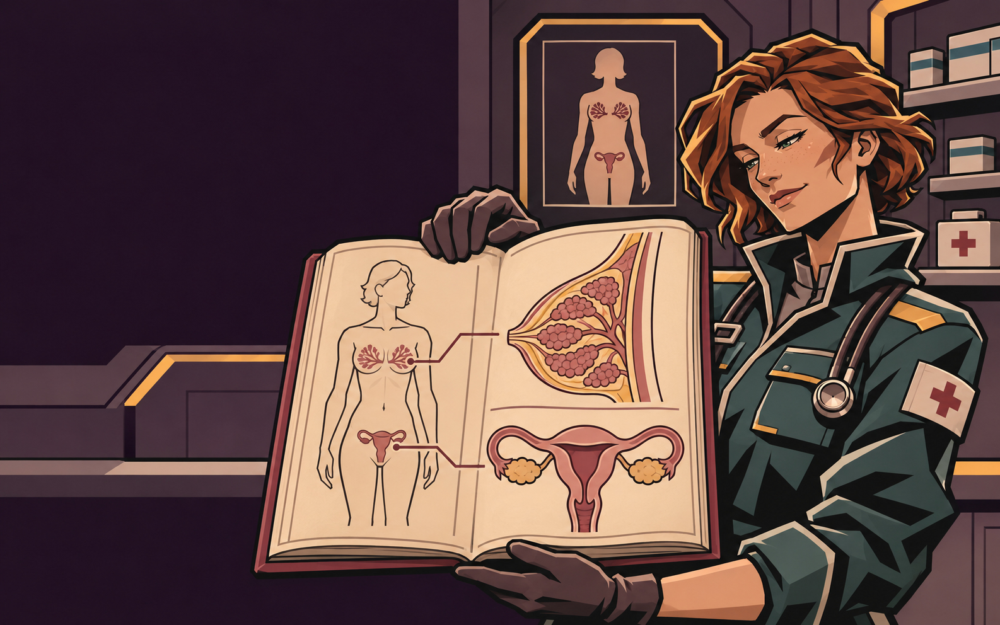
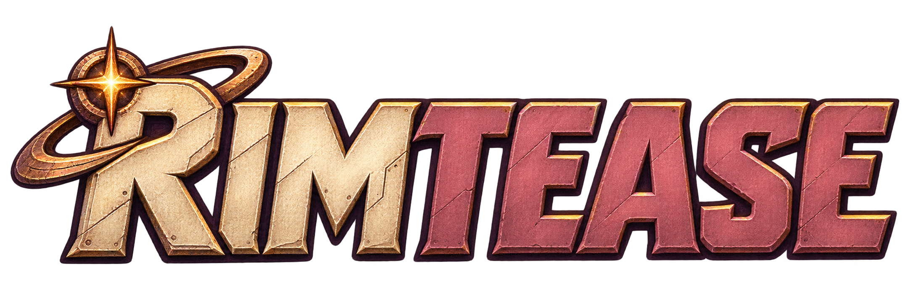
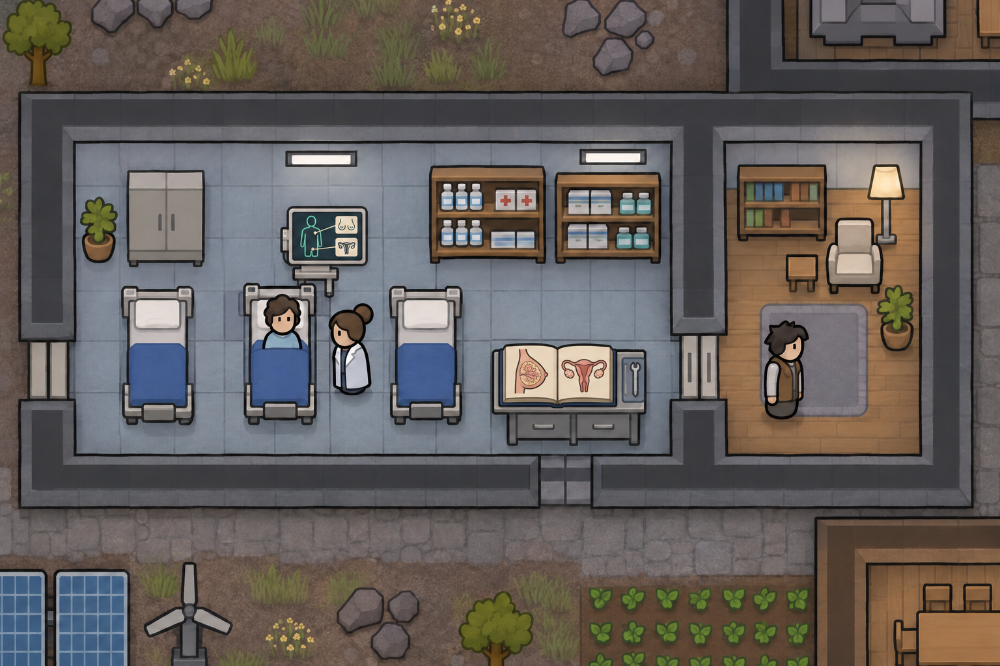

<nav class="rt-mod-breadcrumb" aria-label="Breadcrumb"><a href="../index.md#the-mods" data-catalog-back>← All mods</a>/Body</nav>
<header class="rt-mod-masthead">

Collection
Body

RimTease collection · Anatomy &amp; medicine<h1>Body</h1>
Every body tells a story.

Give each body its own anatomy. Make changes through the familiar health and surgery systems.

18+In developmentNo release yet
<a class="rt-download-button" href="#installation">Installation preview ↓</a>

</header>

<strong>Demo catalogue</strong>Illustrative images and example dependencies. No downloads yet.

<section class="rt-mod-overview" aria-labelledby="inside-title"><h2 id="inside-title">A closer look</h2><figure class="rt-game-scene"><button class="rt-hotspot" type="button" style="--x:32%;--y:35%" data-feature="0" aria-label="Extended anatomy" aria-pressed="true" aria-controls="feature-caption">1</button><button class="rt-hotspot" type="button" style="--x:57%;--y:59%" data-feature="1" aria-label="Medical atlas" aria-pressed="false" aria-controls="feature-caption">2</button><button class="rt-hotspot" type="button" style="--x:82%;--y:55%" data-feature="2" aria-label="Anatomy and appearance" aria-pressed="false" aria-controls="feature-caption">3</button><figcaption>Gameplay mock-up</figcaption></figure>

<button type="button" data-feature="0" aria-pressed="true" aria-controls="feature-caption">1Extended anatomy</button><button type="button" data-feature="1" aria-pressed="false" aria-controls="feature-caption">2Medical atlas</button><button type="button" data-feature="2" aria-pressed="false" aria-controls="feature-caption">3Anatomy and appearance</button>

Describe supported mammary and reproductive structures alongside the native body.

Show present, absent or replaced structures in a medical atlas.

Changing appearance preserves anatomy, health and biological functions.

</section>
<aside class="rt-requirements" aria-labelledby="requirements-title">Before you play<h2 id="requirements-title">Required mods</h2>
Install these alongside Body.
<ul class="rt-requirement-list"><li><a href="https://0n3m0r3.github.io/rimweave-docs/">RimWeave ↗</a>The shared framework.</li></ul>

View installation preview

Example for RimWorld 1.7. Downloads are unavailable; this is not a verified load order.
<ol><li>RimWorld 1.7</li><li><a href="https://0n3m0r3.github.io/rimweave-docs/">RimWeave ↗</a></li><li><a href="body.md" data-mod-link>Body</a></li></ol>
<button type="button" disabled>Steam Workshop</button><button type="button" disabled>Download ZIP</button>

</aside>

<nav class="rt-page-footer" aria-label="Mod navigation"><a href="../index.md#the-mods" data-catalog-back>← Back to the collection</a></nav>

