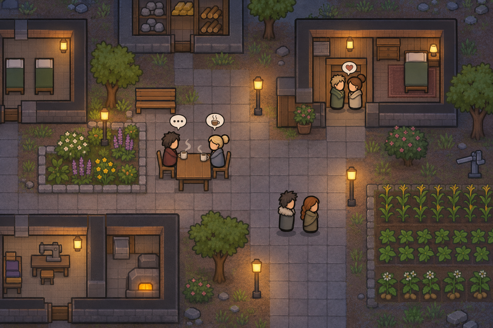

<nav class="rt-mod-breadcrumb" aria-label="Breadcrumb"><a href="../index.md#the-mods" data-catalog-back>← All mods</a>/RimTease</nav>
<header class="rt-mod-masthead">

Collection
RimTease

RimTease collection · Relationships &amp; rules<h1>RimTease</h1>
Intimacy comes to the rim.

Give your colonists an intimate life, with their own preferences and your colony’s rules.

18+In developmentNo release yet
<a class="rt-download-button" href="#installation">Installation preview ↓</a>

</header>

<strong>Demo catalogue</strong>Illustrative images and example dependencies. No downloads yet.

<section class="rt-mod-overview" aria-labelledby="inside-title"><h2 id="inside-title">A closer look</h2><figure class="rt-game-scene"><button class="rt-hotspot" type="button" style="--x:37%;--y:43%" data-feature="0" aria-label="Preferences & traits" aria-pressed="true" aria-controls="feature-caption">1</button><button class="rt-hotspot" type="button" style="--x:72%;--y:28%" data-feature="1" aria-label="Your colony, your rules" aria-pressed="false" aria-controls="feature-caption">2</button><button class="rt-hotspot" type="button" style="--x:60%;--y:68%" data-feature="2" aria-label="Time together" aria-pressed="false" aria-controls="feature-caption">3</button><figcaption>Gameplay mock-up</figcaption></figure>

<button type="button" data-feature="0" aria-pressed="true" aria-controls="feature-caption">1Preferences & traits</button><button type="button" data-feature="1" aria-pressed="false" aria-controls="feature-caption">2Your colony, your rules</button><button type="button" data-feature="2" aria-pressed="false" aria-controls="feature-caption">3Time together</button>

Colonists have their own tastes. A player order and a willing participant are different things.

Set where activities happen and who can take part.

Make room for social moments and private activities in everyday colony life.

</section>
<aside class="rt-requirements" aria-labelledby="requirements-title">Before you play<h2 id="requirements-title">Required mods</h2>
Install these alongside RimTease.
<ul class="rt-requirement-list"><li><a href="https://0n3m0r3.github.io/rimweave-docs/">RimWeave ↗</a>The shared framework.</li><li><a href="body.md" data-mod-link>Body</a>Anatomy and medical changes.</li></ul>
<h3>Optional</h3>
<a href="themes.md" data-mod-link>Themes</a> adds visual choices.

View installation preview

Example for RimWorld 1.7. Downloads are unavailable; this is not a verified load order.
<ol><li>RimWorld 1.7</li><li><a href="https://0n3m0r3.github.io/rimweave-docs/">RimWeave ↗</a></li><li><a href="body.md" data-mod-link>Body</a></li><li><a href="core.md" data-mod-link>RimTease</a></li></ol>
<button type="button" disabled>Steam Workshop</button><button type="button" disabled>Download ZIP</button>

</aside>

<nav class="rt-page-footer" aria-label="Mod navigation"><a href="../index.md#the-mods" data-catalog-back>← Back to the collection</a></nav>

