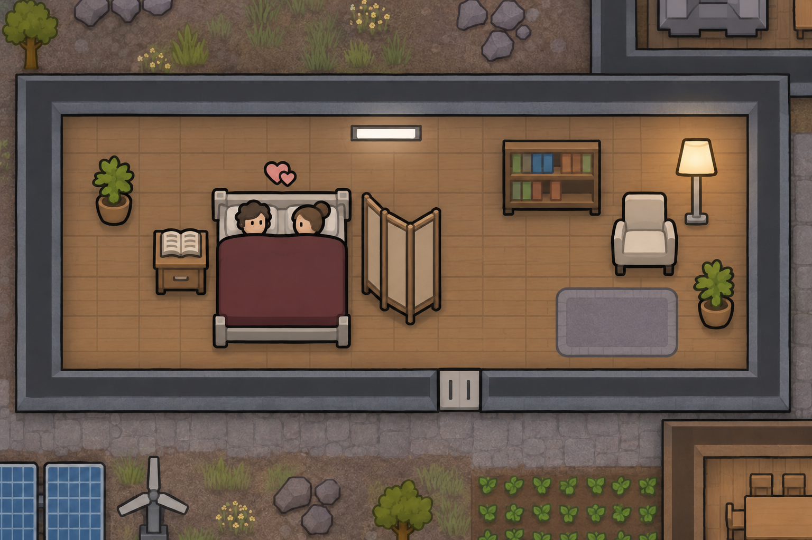

<nav class="rt-mod-breadcrumb" aria-label="Breadcrumb"><a href="../index.md#the-mods" data-catalog-back>← All mods</a>/Extended Positions</nav>
<header class="rt-mod-masthead">

Collection
Extended Positions

RimTease collection · Activities<h1>Extended Positions</h1>
More ways to be together.

Bring more variety to the moments your colonists share.

18+Concept modNo release yet
<a class="rt-download-button" href="#installation">Installation preview ↓</a>

</header>

<strong>Demo catalogue</strong>Illustrative images and example dependencies. No downloads yet.

<section class="rt-mod-overview" aria-labelledby="inside-title"><h2 id="inside-title">Inside the concept</h2>
An example for exploring the collection. Its name, features and dependencies are illustrative.

<section>01<h3>More intimate variety</h3>
A broader repertoire for your colonists’ intimate activities.
</section><section>02<h3>Beyond one setting</h3>
The room illustration explores the furniture, space and privacy around those activities.
</section><section>03<h3>Room for other mods</h3>
Other themed mods can build on this repertoire, as BDSM does in this demo.
</section>
<figure class="rt-game-scene"><figcaption>A private room for intimate activities · gameplay mock-up</figcaption></figure></section>
<aside class="rt-requirements" aria-labelledby="requirements-title">Before you play<h2 id="requirements-title">Required mods</h2>
Install these alongside Extended Positions.
<ul class="rt-requirement-list"><li><a href="core.md" data-mod-link>RimTease</a>Preferences, relationships and colony rules.</li><li><a href="body.md" data-mod-link>Body</a>Anatomy and medical changes.</li></ul>
<h3>Also needed</h3>
Required by the mods above.
<ul><li><a href="https://0n3m0r3.github.io/rimweave-docs/">RimWeave ↗</a></li></ul>

<h3>Optional</h3>
<a href="themes.md" data-mod-link>Themes</a> adds visual choices.

View installation preview

Example for RimWorld 1.7. Downloads are unavailable; this is not a verified load order.
<ol><li>RimWorld 1.7</li><li><a href="https://0n3m0r3.github.io/rimweave-docs/">RimWeave ↗</a></li><li><a href="body.md" data-mod-link>Body</a></li><li><a href="core.md" data-mod-link>RimTease</a></li><li><a href="positions.md" data-mod-link>Extended Positions</a></li></ol>
<button type="button" disabled>Steam Workshop</button><button type="button" disabled>Download ZIP</button>

</aside>

<nav class="rt-page-footer" aria-label="Mod navigation"><a href="../index.md#the-mods" data-catalog-back>← Back to the collection</a></nav>

